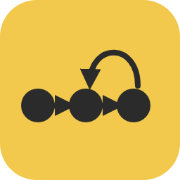
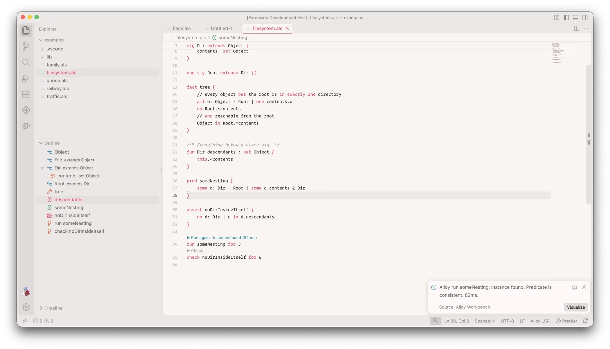
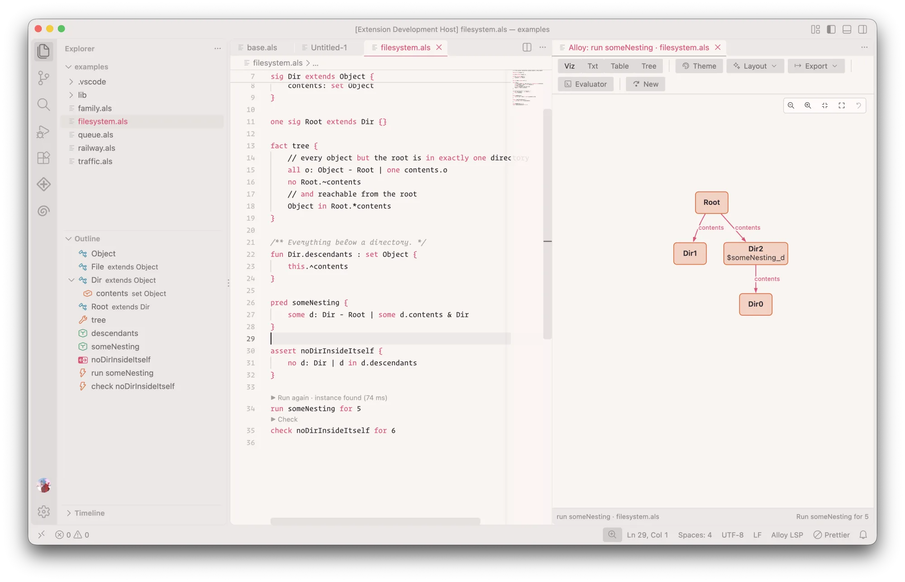

# Alloy Workbench
  

An extension for writing [Alloy 6](https://alloytools.org) models in VS Code: a
language server that knows the language, and the Alloy app's visualizer,
evaluator and themes, so you don't have to leave the editor to run a command
and look at what it found.

The language server is powered by [Langium](https://langium.org). Running
commands uses Alloy 6.2.0, which the extension ships and runs as is, so what
you get is what the Alloy app gives you. This is not an official AlloyTools
project.



## Features

- **Diagnostics as you type**, checked against the Alloy Analyzer on the
  AlloyTools model corpus.
- **Navigation and editing:** go to definition, references, hover,
  completion, rename, an outline, formatting, and inferred types as hints.
- **Run and check** from a code lens above every command.
- **The Alloy app's visualizer:** graph, text, table and tree views, traces
  state by state, and **New** for another solution, trace, initial state or
  fork. The graph is drawn in your editor's colours, with nodes you can drag.
- **The evaluator**, in the state you're on.
- **Themes** (`.thm` files) with projection and **Magic Layout**, and export.
- **Unsat cores** of a holding check (with the MiniSat with Unsat Core
  solver), the metamodel, the app's sample models, its solver options as
  settings, and its output in a log panel.



## Before you install

Running commands needs Java 17 or later. The extension uses `java` from your
`PATH`; set `alloy-lsp.analyzer.java` to use another. Editing works without
Java.

The extension collects no data and has no telemetry. Alloy runs on your
machine, and nothing leaves it.

## Building it

With Node 22 and a JDK 17 or later:

```sh
npm ci
npm run langium:generate
npm run package
```

That fetches the Alloy jar (checking its SHA-256), builds everything and
leaves `packages/extension/alloy-<version>.vsix`. `npm test` runs the unit
tests and `npm run test:oracle` checks our diagnostics against the jar.

## Releasing

1. Set the version in `packages/extension/package.json`, add it to the
   [CHANGELOG](CHANGELOG.md), and push a tag for it, e.g. `v0.1.0`.
   The **release** workflow builds, tests and attaches the `.vsix` to a GitHub
   release.
2. Try that `.vsix`, then run the **publish** workflow by hand with the tag. It
   uploads the release's own `.vsix` to the VS Code Marketplace and Open VSX.

Publishing needs two repository secrets: `VSCE_PAT`, an Azure DevOps token
with Marketplace › Manage for the `praisethemoon` publisher, and `OVSX_PAT`,
an Open VSX token with the `praisethemoon` namespace created.

## Licence

MIT, see [LICENSE](LICENSE). The bundled Alloy and the other software inside the
extension are listed with their licences in
[THIRD_PARTY_NOTICES.md](packages/extension/THIRD_PARTY_NOTICES.md).
