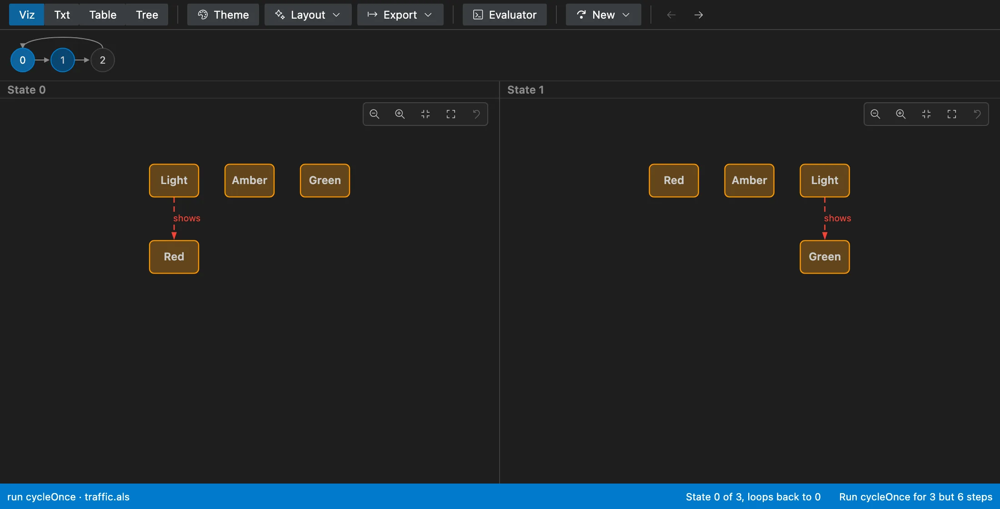
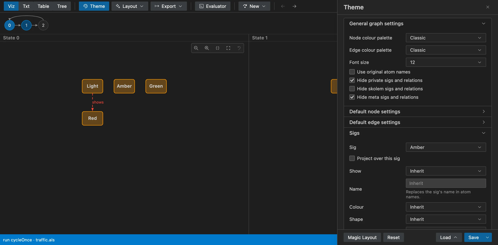
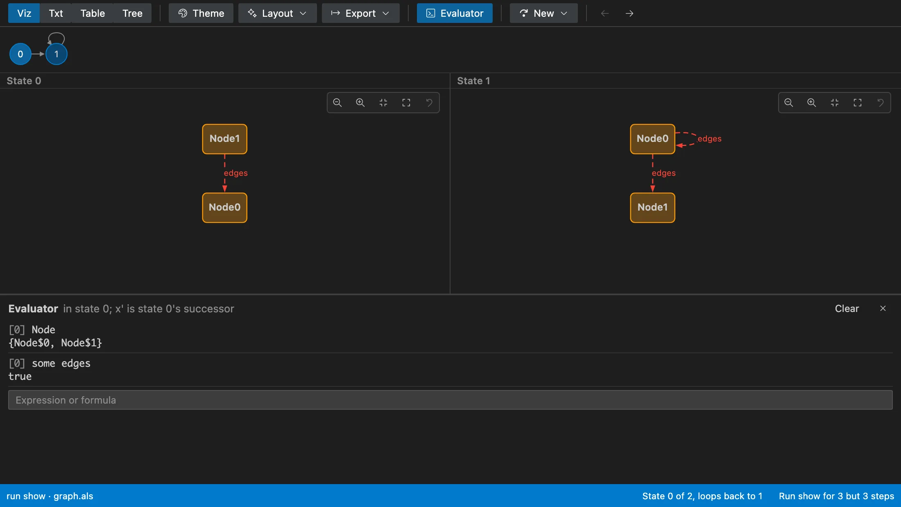

# Alloy for VS Code
  

An extension for writing [Alloy 6](https://alloytools.org) models in VS Code: a
language server that knows the language, and the Alloy app's visualizer,
evaluator and themes, so you don't have to leave the editor to run a command
and look at what it found.

It ships Alloy 6.2.0 and runs it as is, so what you get is what the Alloy app
gives you. This is not an official AlloyTools project.

## What it does

Errors as you type, checked against the Alloy Analyzer on the AlloyTools model
corpus. Go to definition, references, hover, completion, rename, formatting,
and the inferred types of `let` bindings as hints.

Every `run` and `check` has a code lens above it. A run opens the visualizer
with the instance; a trace shows the state you're on beside the next one, and
**New** asks for another solution, trace, initial state or fork, as the app's
buttons do.



Themes work as in the app: `.thm` files load and save, with projection, and
**Magic Layout** makes one for you. The graph is drawn in your editor's
colours; drag nodes around, zoom, and hover an atom to see its relations.



The evaluator answers expressions and formulas in the state you're on.
Double-click an atom in the graph to put its name there.



There's also the Alloy app's solver options as settings (`alloy-lsp.analyzer.*`),
its output in a log panel, the unsat core of a check that holds (with the
MiniSat with Unsat Core solver), the metamodel, and the app's sample models.

## Before you install

Running commands needs Java 17 or later. The extension uses `java` from your
`PATH`; set `alloy-lsp.analyzer.java` to use another. Editing works without
Java.

The extension collects no data and has no telemetry. Alloy runs on your
machine, and nothing leaves it.

## Building it

With Node 22 and a JDK 17 or later:

```sh
npm ci
npm run langium:generate
npm run package
```

That fetches the Alloy jar (checking its SHA-256), builds everything and
leaves `packages/extension/alloy-<version>.vsix`. `npm test` runs the unit
tests and `npm run test:oracle` checks our diagnostics against the jar.

## Releasing

1. Set the version in `packages/extension/package.json`, add it to the
   [CHANGELOG](CHANGELOG.md), and push a tag for it, e.g. `v0.1.0`.
   The **release** workflow builds, tests and attaches the `.vsix` to a GitHub
   release.
2. Try that `.vsix`, then run the **publish** workflow by hand with the tag. It
   uploads the release's own `.vsix` to the VS Code Marketplace and Open VSX.

Publishing needs two repository secrets: `VSCE_PAT`, an Azure DevOps token
with Marketplace › Manage for the `praisethemoon` publisher, and `OVSX_PAT`,
an Open VSX token with the `praisethemoon` namespace created.

## Licence

MIT, see [LICENSE](LICENSE). The bundled Alloy and the other software inside the
extension are listed with their licences in
[THIRD_PARTY_NOTICES.md](packages/extension/THIRD_PARTY_NOTICES.md).
